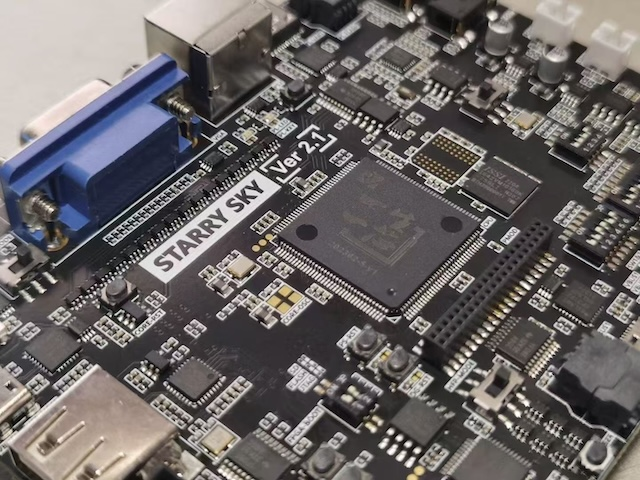



### RISC-V CPU from Scratch (2022)

In 2022 (the pre-LLM era!), I built a five-stage pipelined RV64 CPU from scratch in Verilog, together with its runtime environment in C, as part of the [One Student One Chip (一生一芯)](https://ysyx.oscc.cc/) program. The design was taped out in the first batch of Session 4, and the chip successfully runs the [RT-Thread](https://www.rt-thread.io/) operating system.

 

My Chip and Board

